# Audit game design — Stargate SG-1 3D

Date : 29 octobre 2026. Version : `1d2c1e7`, avec les modifications audio locales préexistantes conservées.

## Verdict

Le projet possède déjà un cadre reconnaissable, un parcours de campagne, un moteur tactique utilisable et une expédition RTS structurée. Son principal chantier est la qualité des décisions proposées au joueur. La campagne varie davantage ses décors et ses adversaires que ses problèmes à résoudre. L'expédition propose davantage de systèmes interdépendants, mais une seule configuration de carte et une économie qui manque encore de débouchés.

La direction recommandée est : **commander SG-1 dans des opérations courtes où reconnaissance, compréhension d'une technologie, combat et extraction se répondent**. La porte devient une contrainte logistique et un objectif à protéger ; chaque spécialiste apporte une solution concrète. Cette direction conserve les acquis du projet. Elle doit être validée sur une mission avant d'être étendue aux six mondes.

## Méthode et limites

- Lecture des règles et des parcours dans `main.gd`, `data.gd`, `game_state.gd`, `planet.gd`, `combat.gd`, `combat_realtime.gd`, `outpost_sim.gd`, `outpost.gd`, `outpost_menu.gd`, `hub.gd`, `sgc_walk.gd`, des menus et des tests pertinents.
- Captures natives Godot/Vulkan réalisées pendant cet audit et inspectées. Le parcours campagne est mis en scène par un outil d'audit ; la rencontre de combat est déclenchée avec une équipe repositionnée, puis mise en pause. Cela permet d'examiner les vrais écrans, sans prétendre mesurer une session naturelle.
- Campagne : **343/343 vérifications fonctionnelles réussies**. Expédition : **68/68**. Le test campagne signale aussi des objets non libérés à la sortie. Ces tests vérifient l'intégration ; ils ne prouvent pas l'équilibrage. Le test campagne utilise notamment le niveau 10, augmente les PV et la portée pendant certains contrôles, puis force les morts ennemies.
- Deux sondes isolées confirment le cumul de la traduction et une condition de victoire incohérente. Reproduction : `godot47 --headless --path . res://dev/audit-2026-10-29/rules_probe.tscn`.
- Aucun changement des règles du jeu effectué. Les outils ajoutés sont réservés à l'audit ; les écritures de campagne du parcours capturé sont redirigées vers un fichier isolé.
- Pas de campagne complète jouée manuellement, de test auprès de nouveaux joueurs, de validation tactile au doigt, de mesure thermique, de test audio perceptif ou de benchmark contrôlé. Les captures reflètent les réglages existants, dont le rendu 3D à 100 %. Les FPS affichés ne constituent pas un benchmark.

Dans ce document, **confirmé** désigne une règle lue ou une observation à l'écran ; **risque** désigne une conséquence probable à vérifier en partie ; **proposition** désigne un changement de design.

## Parcours observé

| Étape | État général | Observation principale |
|---|---|---|
| 1. Accueil | Solide | Identité immédiatement reconnaissable ; le rôle de l'expédition reste peu expliqué. |
| 2. SGC | Prometteur | Base incarnée et services localisés ; intérêt décisionnel limité de plusieurs salles. |
| 3. Briefing campagne | Fonctionnel | Destination, cible et récompenses présentes ; renseignements tactiques peu exploitables. |
| 4a. Exploration | Fragile | Équipe et terrain visibles ; objectif opérationnel moins saillant que le compteur de lieux. |
| 4b. Combat | Fonctionnel, à approfondir | Pause et commandes accessibles ; prédiction des tirs, couverts et ordres insuffisante dans l'état capturé. |
| 5. Briefing expédition | Clair | Trois intentions simples : reconnaître, établir, neutraliser. |
| 6. Choix d'équipe | Fonctionnel | Compromis chiffrés explicites ; profils encore surtout statistiques. |
| 7. Engagement | À corriger | Texte sur le premier raid ambigu par rapport au départ réel de son compte à rebours. |
| 8. Commandes | Complet mais dense | Instructions textuelles séparées par périphérique ; apprentissage sans exercice. |
| 9. Options | Utile | Taille d'interface, rendu et réglages disponibles ; leur adéquation au téléphone reste à tester. |
| 10. Pause expédition | Clair, continuité fragile | Reprise évidente et perte de partie annoncée ; absence de sauvegarde. |

### 1 — Accueil

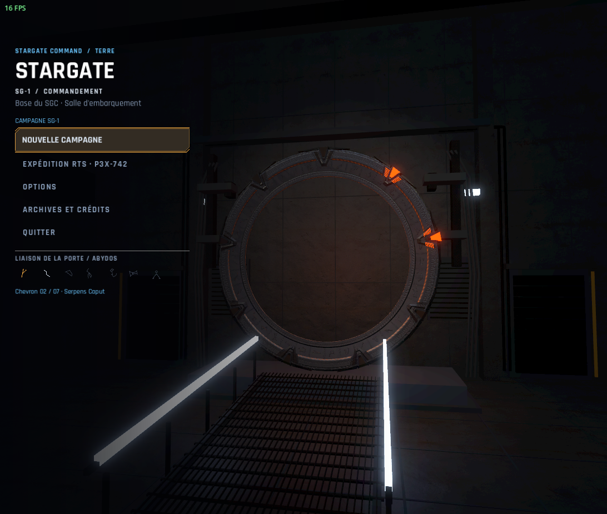

La porte, la rampe et la composition de l'adresse installent l'univers. La campagne est l'entrée principale. Proposition : présenter l'expédition comme une opération autonome de construction et défense, avec une durée cible lorsqu'elle sera mesurée. Risque d'accessibilité : petits libellés bleus et détails sombres ; contraste à mesurer, lecture sur téléphone à vérifier.

### 2 — SGC

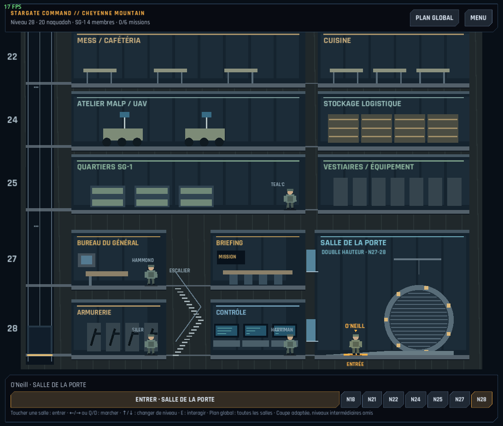

La coupe du SGC offre un lieu de retour mémorable. Les niveaux et le bouton d'interaction sont identifiables. Proposition : une consigne de prochain objectif, puis des accès rapides aux services déjà visités. Le déplacement entre services doit pouvoir conserver sa valeur d'ambiance sans devenir une formalité répétitive. Risque : petits textes de salles et boutons d'étages rapprochés au tactile.

### 3 — Briefing campagne

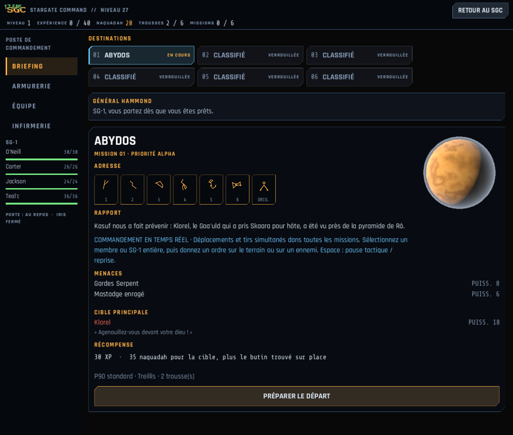

La fiche rassemble les informations et une action de départ visible. Mais « PUISS. 8 » n'explique pas le comportement d'un Garde Serpent, et cette valeur ne pilote pas directement ses caractéristiques de combat. Remplacer ce résumé par rôle, portée, danger et contre-mesure. Les consignes tactiques sont une longue phrase ; les transformer en quelques informations contextuelles, apprises aussi sur le terrain.

### 4a — Exploration

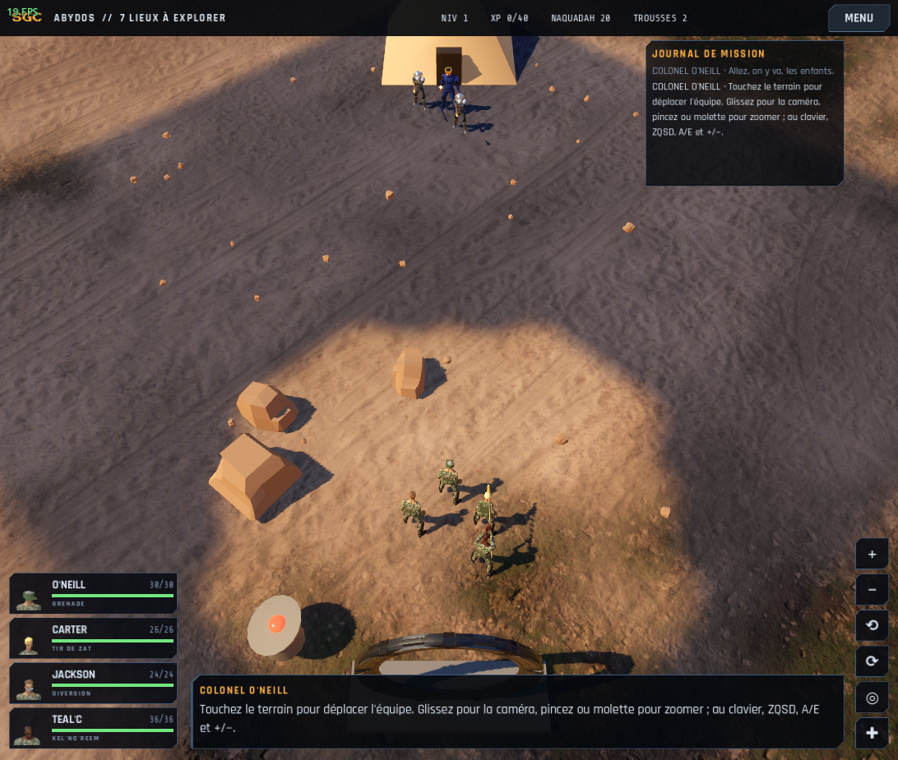

Le terrain occupe l'essentiel de l'écran. La transmission et le journal répètent l'aide aux commandes dans cet état. Proposition : afficher l'objectif actif et une direction utile, réserver le journal à l'historique. La promesse « sauver Skaara » n'est pas traduite par un objectif spécifique à cette arrivée. Les visages des portraits et plusieurs boutons sont petits dans la capture ; leur efficacité au doigt reste inconnue.

### 4b — Combat

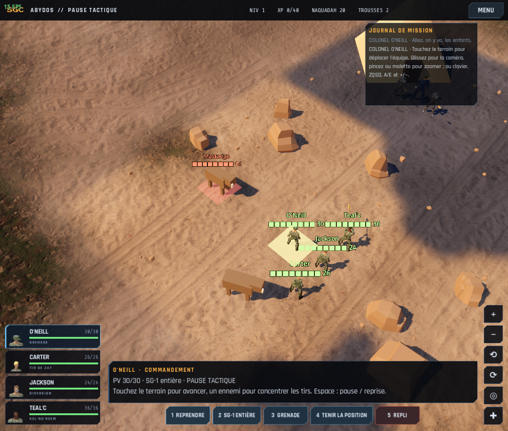

La pause tactique est explicite. Le panneau bas donne les ordres disponibles, mais les étiquettes des membres se chevauchent dans cette formation. Aucun indicateur de couvert ou de probabilité de tir n'est visible dans cet état. Proposition : montrer sélection, destination, cible, portée et protection directionnelle, et simplifier les étiquettes hors sélection. La couleur aide à séparer les camps ; ajouter des formes ou marqueurs distincts pour ne pas dépendre de rouge/vert.

### 5 — Briefing expédition

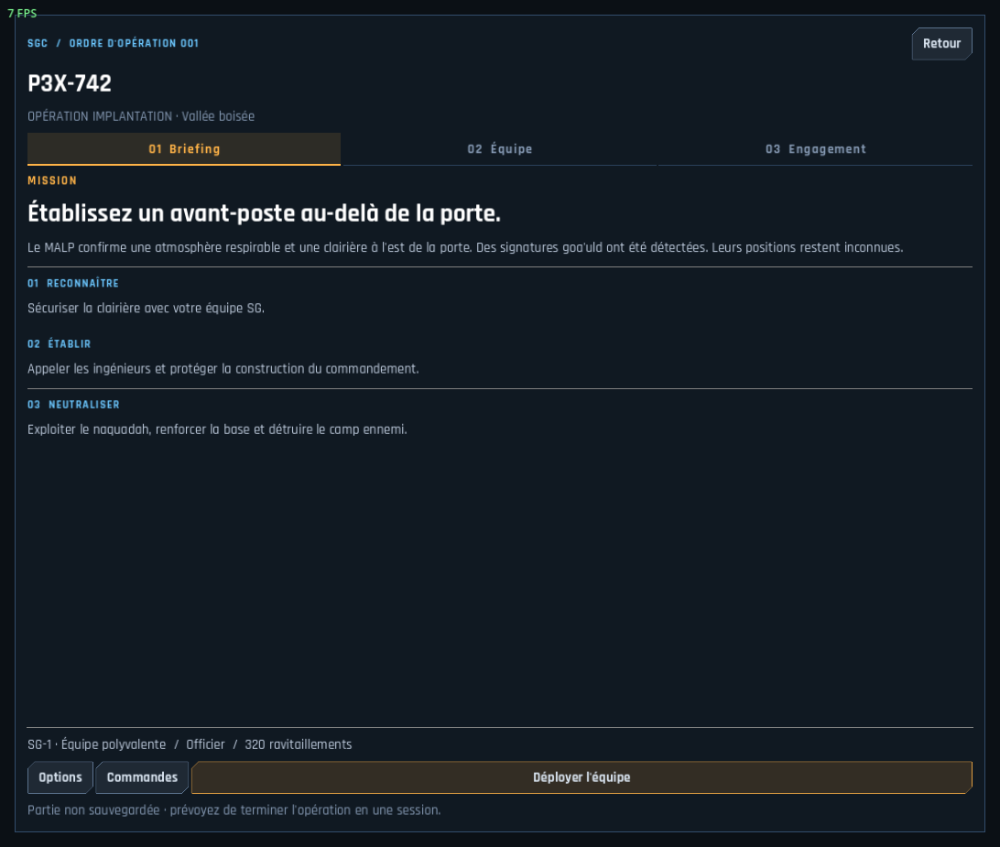

Objectif, phases et déploiement sont clairs. Le résumé et le départ restent visibles. La mention de partie non sauvegardée est présente. Risque : texte secondaire fin et discret ; annoncer aussi une durée une fois celle-ci mesurée.

### 6 — Équipe expédition

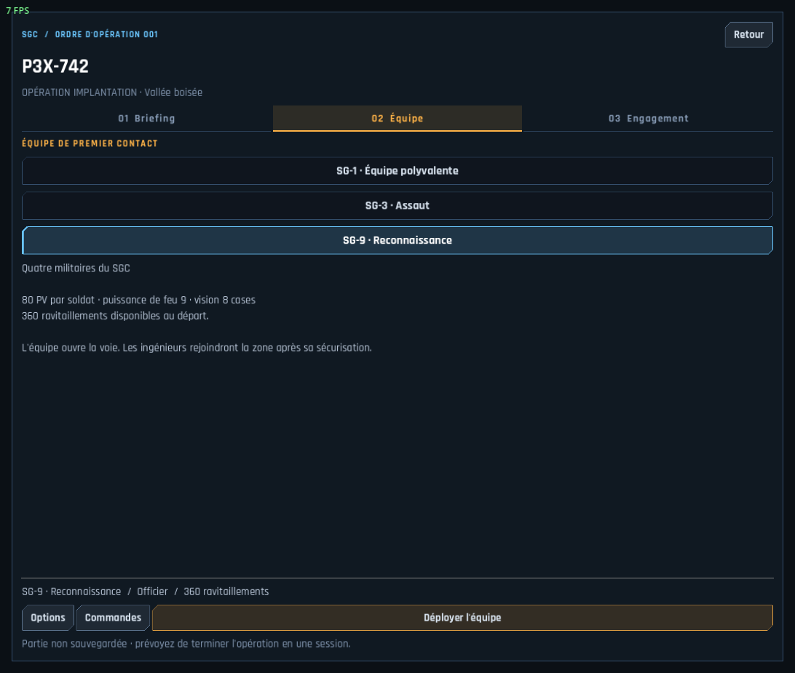

Les PV, dégâts, vision et ressources permettent de comparer les profils. La sélection a un fond et une bordure. Proposition : expliquer le style attendu par une phrase et introduire plus tard un avantage fonctionnel propre à chaque doctrine. Le profil reconnaissance ne doit pas seulement être « un peu moins fort mais plus riche ».

### 7 — Engagement

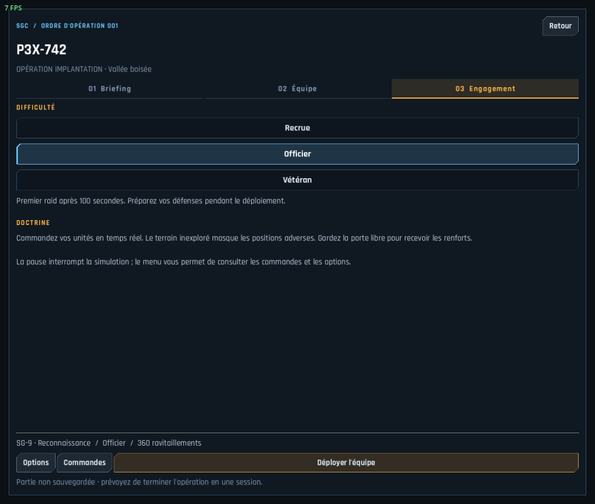

Le choix de difficulté est lisible. « Premier raid après 100 secondes » et « pendant le déploiement » ne précisent pas que le compteur ne diminue qu'en phase `base`. Corriger la promesse : « 100 secondes après la mise en service du commandement ». Indiquer aussi les multiplicateurs ennemis pour décrire toute la difficulté réelle.

### 8 — Commandes

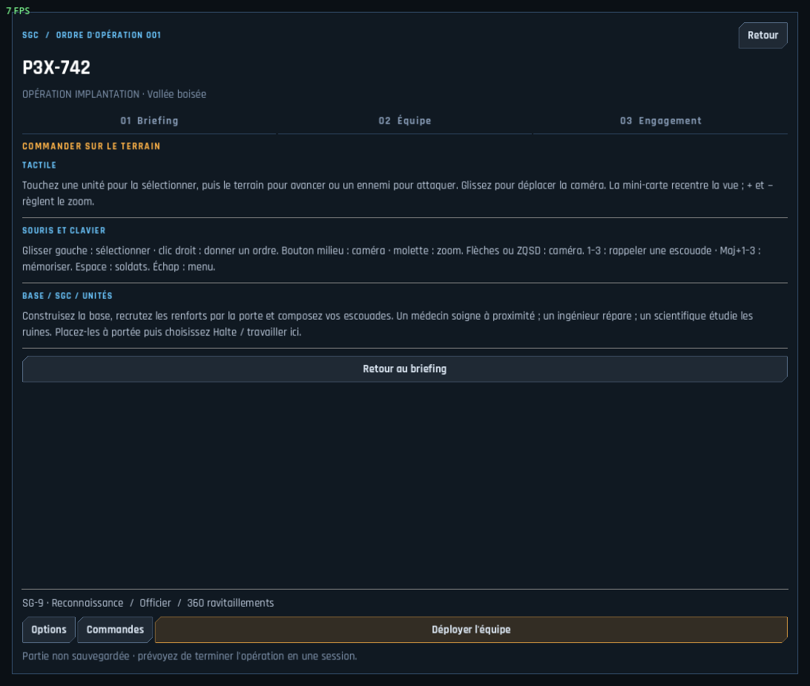

Les commandes tactiles et clavier sont séparées. L'écran exige cependant de mémoriser beaucoup d'actions. Proposition : apprendre sélectionner, déplacer, attaquer, travailler et appeler un convoi au moment où ces actions deviennent utiles. La première réussite de chaque geste doit être observable.

### 9 — Options

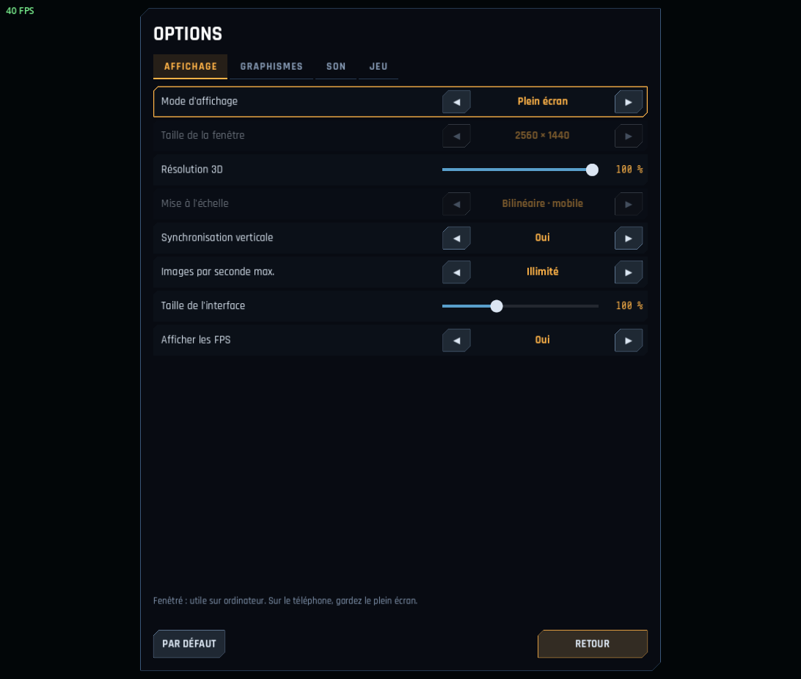

Réglages de taille d'interface, résolution 3D et FPS accessibles. Les lignes désactivées sont visiblement atténuées. Ce constat ne valide ni navigation clavier complète ni conformité d'accessibilité. Tester l'interface agrandie, les longs libellés, les interactions au doigt et les vibrations/secousses désactivées. Les captures ont été faites avec les réglages présents, sans les modifier.

### 10 — Pause expédition

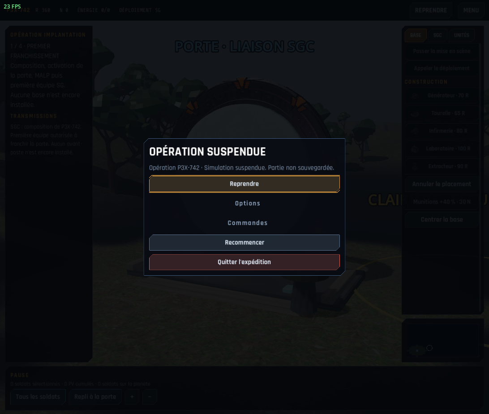

Reprendre est prioritaire ; recommencer et quitter sont différenciés. La simulation est suspendue et l'absence de sauvegarde annoncée. Sur téléphone, l'interruption est un cas courant : une reprise fiable est une fonction de confort prioritaire. Cette capture ne prouve pas la récupération après fermeture du processus Android.

## Ce qui mérite d'être conservé

1. **Le rituel de la porte.** Il donne un sens au départ et au retour. Garder sa version complète lors des premières traversées et des événements importants ; offrir ensuite une version courte.
2. **L'équipe reconnaissable.** Les membres ont déjà PV, armes et capacités distincts. C'est une base pour construire des missions autour de leurs compétences.
3. **La pause tactique.** Elle correspond à la conduite d'une petite équipe et au contexte mobile. Elle permet de privilégier les choix à la vitesse d'exécution.
4. **Les phases d'expédition.** Franchissement, reconnaissance, demande d'ingénieurs puis installation forment une progression intelligible.
5. **La logistique visible.** Les renforts traversent réellement la porte et les spécialistes ont une présence sur le terrain. Cette cohérence peut devenir une mécanique centrale.
6. **Le brouillard RTS et la mémoire des bâtiments.** Les positions mobiles adverses hors vision ne sont pas simplement révélées au joueur. Bon point d'appui pour la reconnaissance.
7. **Une architecture testable.** Les règles d'expédition sont séparées du rendu et le combat avance par pas de simulation. Cela permet de vérifier les futures règles de design.

## Diagnostic de fond

### A — La campagne répète une recette trop stable — priorité haute

**Confirmé.** `planet.gd:111` génère pour chaque monde trois combats, une caisse, une ruine, un allié, un piège et un boss. Les cartes partagent une grille 16×16, un départ et un boss à des coordonnées fixes. Les obstacles et les lieux secondaires changent de position. `main.gd:1325` valide la libération en battant le boss.

**Risque joueur.** Après avoir compris un monde, le joueur peut appliquer la même stratégie aux suivants. Une nouvelle palette et davantage de PV ennemis ne renouvellent pas nécessairement l'expérience. La génération aléatoire donne de la variation spatiale, mais ne garantit ni situation tactique intéressante ni arc dramatique.

**Proposition.** Donner à chaque monde un verbe et une contrainte propres. Abydos : sauver un hôte. Chulak : rallier une résistance. Cimmeria : restaurer un dispositif. Netu : infiltrer puis évacuer. Hala : contenir une propagation. Dakara : désactiver une arme sous pression. Ce sont des directions de mission, pas six nouveaux systèmes à développer immédiatement.

**Validation.** Faire expliquer à un testeur ce qui différencie deux missions sans nommer décor ni ennemi. La réponse doit porter sur les actions et les décisions.

### B — Les boss ne tiennent pas encore une promesse de rencontre unique — priorité haute

**Confirmé.** `combat.gd:102` attribue aux boss la même formule : PV `30 + 18 × palier`, dégâts `6 + 3 × palier`, portée 6. Chaque boss a deux gardes. Leur déplacement et leur choix de cible utilisent le même moteur. Les anciens champs `pow` ne suffisent pas à produire des comportements spécifiques.

**Risque joueur.** Les noms prestigieux peuvent créer une attente que le combat ne satisfait pas. Klorel dans le corps de Skaara, un Réplicateur humanoïde et Anubis devraient demander des résolutions différentes.

**Proposition.** Pour le premier boss seulement, créer une attaque annoncée, une contre-mesure et un objectif autre que ses PV. Exemple : neutraliser le bouclier puis immobiliser Klorel pour permettre une intervention sur l'hôte. Réutiliser les mécanismes existants avant d'ajouter des phases complexes.

### C — La tactique manque de règles spatiales explicites — priorité haute

**Confirmé.** `hit_chance()` réduit la précision selon distance et couvert voisin de la cible. `_fire()` dans le moteur temps réel ne vérifie pas de ligne de vue bloquante. Un obstacle peut interdire le déplacement sans interdire le tir au travers. L'expédition calcule également les tirs par distance, sans test d'occlusion dans `_step_entity()`.

**Risque joueur.** Le décor peut sembler protéger davantage qu'il ne protège réellement. Un joueur ne peut pas prendre une bonne décision de positionnement si la règle est invisible ou contredit le volume affiché.

**Proposition.** Définir trois catégories lisibles : obstacle opaque, couvert bas, décor traversable. Afficher la conséquence avant l'ordre. Une ligne de vue peut être simplifiée sur la grille : la cohérence est plus importante qu'une simulation balistique détaillée.

**Validation.** Placer deux unités de part et d'autre d'un volume opaque : tir refusé et raison visible. Au couvert bas : tir autorisé et protection indiquée du bon côté.

### D — Les identités de SG-1 sont davantage des boutons que des solutions — priorité haute

**Confirmé.** O'Neill lance une grenade, Carter étourdit, Daniel étourdit globalement ou réduit les dégâts du boss, Teal'c se soigne, Bra'tac frappe au contact. L'étude des ruines est un choix de menu qui ne constitue pas une opération spatiale propre à Daniel. L'atelier MALP présente surtout un lieu et du texte, sans boucle active de renseignement préalable dans la campagne examinée.

**Proposition.** Donner à chaque membre un usage hors combat et une synergie simple : O'Neill coordonne/replie, Carter neutralise une technologie, Daniel révèle une solution et négocie, Teal'c identifie une menace jaffa ou couvre une intervention. Le joueur doit choisir qui protéger pendant qu'un autre accomplit l'objectif.

**Limite de périmètre.** Inutile d'ajouter quatre arbres de compétences. Une interaction utile par membre dans une seule mission suffit pour éprouver cette direction.

### E — Le passage au temps réel nécessite un nouvel équilibrage — priorité haute

**Confirmé.** Les tirs alliés reviennent toutes les 1,3 s, ennemis toutes les 2,3 s ; première disponibilité à 0,8 s contre 1,8 s. Les alliés se déplacent à 4 unités/s contre 3. Le combat reprend des caractéristiques du système précédent, mais les anciennes valeurs de mouvement ennemi ne pilotent pas cette vitesse. Des ennemis autrefois distincts par leur mobilité se ressemblent donc davantage.

**Risque.** Le tir concentré, l'avantage du premier tir et le tir en déplacement peuvent écraser d'autres choix. Le harcèlement par une équipe plus rapide mérite un test spécifique ; son caractère dominant n'a pas été démontré ici.

**Proposition.** Mesurer avant de retoucher : durée des rencontres, temps avant premier KO, usage des capacités, répartition des dégâts et fréquence du repositionnement. Vérifier trois approches sur les mêmes graines : attendre et tirer, concentrer les tirs, utiliser couvert et capacités. La troisième doit apporter un bénéfice visible sans rendre les deux premières systématiquement impossibles.

### F — Traduction de Daniel : réduction permanente cumulable — correction immédiate

**Confirmé par sonde.** `_apply_queued()` remplace les dégâts actuels du boss par 75 % de ceux-ci, arrondis à l'entier inférieur, à chaque utilisation. Le délai de recharge est de 15 s ; aucun retour à la valeur initiale n'est prévu. Résultat : **24 → 18 → 13 → 9 → 6 → 4** après cinq utilisations.

**Effet.** Récompense potentiellement l'attente jusqu'à rendre le boss presque inoffensif. L'intitulé ne signale pas cette accumulation.

**Proposition.** Choisir une règle explicite : réduction unique de 25 % pendant la rencontre, ou affaiblissement temporaire non cumulable. Utiliser les dégâts de base comme référence. Si la traduction doit résoudre une défense, la lier à une intervention protégée sur une console.

### G — La progression récompense surtout l'accumulation — priorité haute

**Confirmé.** Monter de niveau augmente les PV, les dégâts et la précision, et soigne toute l'équipe. L'armurerie propose des rangs croissants de dégâts/précision et de protection pour toute l'équipe. Les armes n'imposent pas de contreparties. Une amélioration P90 s'applique même aux lances, selon les règles de bonus partagé.

**Risque.** Les achats deviennent un ordre d'acquisition, plutôt qu'une adaptation à la mission. Le soin complet au niveau peut rendre l'ordre des lieux plus important que le risque fictionnel. L'arrivée de Bra'tac augmente aussi le nombre d'unités déployées au lieu de créer un choix d'équipe : c'est un saut de puissance à équilibrer.

**Proposition.** Garder les récompenses simples, mais offrir deux choix exclusifs de matériel au départ : neutralisation non létale contre puissance, protection contre mobilité, reconnaissance contre stock de soins. Ne pas imposer une sélection de quatre membres tant que les missions n'offrent pas de rôles équitablement utiles.

### H — Rejouer remet les lieux à zéro mais conserve les gains — priorité haute

**Confirmé par lecture.** `start_planet()` crée une nouvelle planète avec une nouvelle graine. La sauvegarde conserve XP, naquadah, équipement, PV et nombre de missions terminées ; elle ne conserve pas la résolution des lieux. Les planètes déjà libérées restent accessibles. Les gains de combat et de ruines alimentent la progression persistante. Un retour normal soigne l'équipe.

**Risque.** Récolter, rentrer, recommencer peut devenir le moyen le plus sûr de progresser. Une extraction anticipée peut être souhaitable dans un jeu d'opérations ; elle doit alors faire partie de son économie assumée. L'audit ne mesure pas le rendement horaire de cette stratégie.

**Proposition.** Distinguer récompense de première libération et récompense de répétition, et décider explicitement de la règle de reprise d'une mission. Ne pas simplement supprimer tous les gains d'une extraction : cela découragerait une décision de retraite qui peut être intéressante.

### I — Échec et extraction donnent des messages contradictoires — priorité haute

**Confirmé.** En cas de défaite totale, le jeu retire la moitié de tout le naquadah détenu. Une fuite termine immédiatement le combat et replace l'équipe près de la porte. Après une issue autre que la défaite totale, les membres KO reviennent avec au moins 25 % des PV. La validation de planète intervient au boss, avant le retour au SGC.

**Risque.** La défaite punit la réserve accumulée alors que le repli contourne l'exigence d'une extraction physique. Avoir déjà sécurisé une planète puis échouer sur le chemin du retour ne porte pas la même conséquence que « mission accomplie après extraction ».

**Proposition.** Définir quatre résultats : objectif et extraction réussis, extraction partielle, abandon de l'objectif, équipe hors de combat. Expliquer avant de partir ce qui est sécurisé à chaque étape. Pour le repli, utiliser un point de rassemblement ou une courte action d'extraction, avec une option permissive en difficulté d'apprentissage.

### J — Exploration : trop de hasard sans moyens de lecture — priorité moyenne à haute

**Confirmé.** Une ruine propose XP garanti ou activation : 50 % de chance d'obtenir du naquadah, sinon dégâts à toute l'équipe. Un allié est choisi aléatoirement entre soin, monnaie et XP. Le piège de planeur inflige des dégâts au déclenchement. Les lieux ont un schéma récurrent.

**Risque.** Le joueur reçoit surtout des résultats, sans pouvoir transformer des observations en décisions. Une loterie explicite peut être amusante ; elle ne remplace pas une enquête ou une prise de risque informée.

**Proposition.** Permettre d'obtenir un indice avec Daniel ou Carter : mécanisme instable, piste de patrouille, fenêtre de passage du planeur. Le choix devient « combien de temps consacrer pour réduire ce risque ? ». Donner aux ruines une récompense liée à la mission : passage, code, renseignement, dispositif temporaire.

### K — L'expédition a une économie prometteuse mais étroite — priorité haute

**Confirmé.** Le commandement donne +4 ravitaillements/s. Une mine alimentée donne +2 naquadah/s. La recherche coûte 30 naquadah et donne une unique amélioration de dégâts de 40 %. Le scientifique apporte +50 naquadah et +100 ravitaillements après l'étude, en plus de la découverte des ruines (+30 N, +75 R). Aucune autre dépense de naquadah n'est présente dans cette simulation.

**Conséquence.** Une fois la recherche faite, le naquadah n'a plus de choix de dépense. La découverte simple des ruines fournit déjà les 30 N nécessaires à la seule recherche ; la mine n'est donc pas indispensable à celle-ci. Le scientifique coûte en revanche laboratoire, recrutement et temps de trajet, ce qui affaiblit la valeur marginale de son naquadah tardif.

**Calcul utile, pas mesure de partie.** Trois soldats coûtent 85 R, soit 21,25 s de revenu du QG ; leur préparation prend 18 s. Le revenu soutient donc une cadence élevée de renforts si d'autres dépenses ne l'absorbent pas. Cela rend pertinente l'hypothèse d'une stratégie de masse, sans démontrer qu'elle domine.

**Proposition.** Limiter à trois dépenses de N vraiment concurrentes : recherche, dispositif défensif temporaire, activation scientifique utile à l'objectif. Le scientifique doit permettre une solution différente ou une information décisive, pas seulement restituer des stocks.

### L — Victoire d'expédition incohérente avec l'exploitation — correction immédiate

**Confirmé par sonde.** La condition est `camp détruit ET au moins une mine achevée`. Elle ne demande ni alimentation ni extraction. Avec un camp retiré et une mine achevée sans générateur, le résultat est **victory**, `powered=false`, naquadah extrait **0**. La sonde isole la condition ; elle ne prétend pas reproduire une partie naturelle complète.

**Proposition.** Si « exploiter » reste l'objectif, exiger une quantité réellement extraite, avec une source comptabilisée séparément des ruines. Afficher la progression. Autre option : demander seulement l'installation d'un extracteur et reformuler l'objectif, mais cela donne moins de rôle à l'économie.

### M — Les vagues exercent une pression prévisible — priorité moyenne

**Confirmé.** Elles démarrent après la phase de base, apparaissent dans le même secteur et marchent vers la même zone. Le nombre augmente jusqu'à sept unités ; l'intervalle baisse jusqu'à 45 s. Le camp est la source des vagues. La reconnaissance avant établissement ne fait pas avancer ce compteur.

**Risque.** La carte peut se résoudre par une défense fixe puis une masse critique de soldats. Le temps de reconnaissance sans raid est au contraire une bonne protection de l'apprentissage, à conserver si elle est clairement annoncée.

**Proposition.** Introduire des intentions lisibles avant d'augmenter le nombre : reconnaissance, attaque du générateur, interception du convoi, assaut sur le QG. Donner un avertissement et au moins deux réponses possibles. Ne pas faire apparaître une attaque imprévisible directement dans une zone supposée sécurisée.

### N — Deux modes, deux apprentissages et deux états de partie — priorité de cadrage

**Confirmé.** Campagne et expédition ont des simulations, ressources, commandes et sauvegardes différentes. Espace met le combat de campagne en pause tactique ; en expédition, il sélectionne les soldats. L'expédition est autonome et ne sauvegarde pas sa progression.

**Proposition.** Conserver l'expédition comme laboratoire autonome à court terme. Harmoniser les commandes communes et la terminologie. Ne pas fusionner brutalement les sauvegardes ou économies : choisir d'abord quelles mécaniques d'expédition améliorent une mission de campagne. Une porte avec renforts limités peut suffire ; toutes les missions n'ont pas besoin d'une base.

### O — Continuité mobile et rythme — priorité haute

**Confirmé.** La sauvegarde campagne ne décrit pas une mission en cours. Les expéditions n'ont pas de sauvegarde. Les systèmes réagissent aux interruptions par une pause ; cela ne persiste pas une partie après fermeture. La séquence de composition campagne attend chacun des sept chevrons ; le retour rejoue une séquence IDC/iris. Aucun raccourci de campagne équivalent au passage de mise en scène RTS n'a été trouvé dans les chemins examinés.

**Proposition.** Prioriser une sauvegarde/reprise explicite de l'expédition et un contrat de reprise clair pour la campagne. Conserver les séquences complètes à la première découverte, rendre les répétitions abrégées sur demande. Mesurer le temps entre « nouvelle campagne » et premier ordre qui produit un effet, plutôt que de se fixer une durée à partir du seul code.

## Première mission proposée : Abydos, sauver Skaara

Il s'agit d'une proposition, pas d'un contenu déjà implémenté. Durée cible initiale : **12–18 minutes**, à réviser après tests.

| Temps cible | Situation | Décision du joueur | Système réutilisé |
|---|---|---|---|
| 0–2 min | Arrivée, premier contact derrière un couvert | Sélectionner, avancer, mettre en pause | Porte, déplacement, pause |
| 2–5 min | Kasuf fournit un indice ; deux approches de la pyramide | Passage court exposé ou détour sûr | Transmission, points d'intérêt, terrain |
| 5–8 min | Console verrouillée, patrouille en approche | Protéger Daniel pour obtenir le code ou engager directement | Console, interaction, combat |
| 8–12 min | Klorel protégé par un dispositif | Carter désactive pendant que l'équipe contrôle les gardes | Capacité/interaction, gardes, dispositif |
| 12–15 min | Skaara est récupéré ; la porte doit être rejointe | Couvrir le retour, choisir moment et itinéraire | Déplacement, DHD, extraction |
| 15–18 min | Débriefing | Choisir une amélioration et comprendre les conséquences | SGC, récompenses, briefing suivant |

Contraintes : deux types ennemis maximum, une interaction scientifique, une interaction de traduction, un comportement spécifique du boss. Pas de construction de base dans cette première refonte. L'objectif est d'éprouver une boucle complète avec une charge de développement maîtrisée.

La version minimale peut remplacer l'escorte complexe par un Skaara « récupéré » comme état de mission, puis un objectif de retour de l'équipe. Une escorte physique n'est à ajouter que si elle produit de bonnes décisions sans bloquer le pathfinding.

## Priorités de production

Les tailles ci-dessous sont relatives ; ce ne sont pas des promesses de délai.

| Ordre | Travail | Impact attendu | Taille | Critère de sortie |
|---|---|---|---|---|
| 1 | Traduction non cumulable, victoire conforme à l'objectif, texte du raid exact | Cohérence et confiance | Petite | Règles et textes vérifiés par tests ciblés |
| 2 | Indiquer objectifs, sélection, cible, couvert et ligne de vue | Décisions compréhensibles | Moyenne | Un joueur explique pourquoi un tir est possible et pourquoi il rate |
| 3 | Politique de sauvegarde/reprise et de répétition des récompenses | Continuité et progression | Moyenne à grande | Reprise après fermeture ; gains sans duplication involontaire |
| 4 | Première mission Abydos complète | Valider la promesse du jeu | Grande | Une session avec reconnaissance, intervention, combat et retour |
| 5 | Recalibrer combat et économie sur cette mission | Éviter la stratégie unique | Moyenne | Plusieurs approches viables ; capacités réellement utiles |
| 6 | Rendre une dépense scientifique et une attaque de convoi intéressantes dans l'expédition | Profondeur RTS | Moyenne | Arbitrage visible entre défense, renforts et science |
| 7 | Étendre aux autres planètes avec objectifs distincts | Variété de campagne | Grande | Chaque mission demande au moins une décision nouvelle |

À différer : nouveaux modèles décoratifs sans usage de jeu, nouvelles planètes sur la même recette, arbres de recherche étendus, gestion détaillée du SGC, mode multijoueur, diplomatie généralisée. Les ressources existantes suffisent pour valider la première mission.

## Plan de playtest

Commencer avec cinq personnes découvrant le jeu. Ce nombre sert à détecter des difficultés de compréhension ; il ne permet pas de conclure statistiquement sur l'équilibrage.

1. Sans explication orale, lancer une campagne et trouver le départ. Observer les hésitations, les écrans ouverts et le temps avant le premier ordre utile.
2. En combat, demander de protéger Carter derrière un obstacle. Faire expliquer le couvert et la ligne de tir. Relever ce que l'interface fait croire.
3. Demander de neutraliser une cible et d'utiliser deux capacités. Relever les actions annulées, cibles mal sélectionnées et dégâts subis sans comprendre pourquoi.
4. Présenter une intervention scientifique sous menace. Vérifier que le joueur peut expliquer son bénéfice et pourquoi il protège un membre.
5. Quitter/reprendre, puis revenir au SGC. Demander ce qui a été gagné, perdu et sauvegardé.

Mesurer aussi : durée de chaque rencontre, temps en pause, capacités utilisées par membre, ordres sans effet, survie de chaque membre, achats, retours anticipés et temps des séquences répétées. Pour l'expédition : première construction, première panne, premier raid, dépenses de R/N, usage réel du scientifique et durée totale.

Tests d'équilibrage séparés : mêmes cartes et graines, trois difficultés, au moins trois approches tactiques et plusieurs répétitions pour les tirs aléatoires. Tester explicitement le harcèlement en mouvement, le regroupement permanent, les renforts en continu, l'attente défensive et la répétition d'Abydos. Une stratégie forte n'est un problème que si elle élimine durablement les autres choix ou contredit la promesse de jeu.

## Preuves et reproduction

Captures : dossier `captures/`, prises pendant cette session. `capture.gd` et `capture.tscn` produisent l'accueil, le SGC, le briefing et les états de mission sans utiliser la sauvegarde de campagne réelle comme cible d'écriture. Les captures de préparation et pause RTS proviennent du scénario existant `dev/rts_menu_visual.tscn` exécuté pendant cet audit.

Commandes depuis la racine du projet :

```sh
/root/.local/opt/godot47 --headless --path . res://dev/campaign_realtime_tests.tscn
/root/.local/opt/godot47 --headless --path . res://dev/expedition_tests.tscn
/root/.local/opt/godot47 --headless --path . res://dev/audit-2026-10-29/rules_probe.tscn
./start.sh res://dev/audit-2026-10-29/capture.tscn
./start.sh res://dev/rts_menu_visual.tscn
```

Les références `fichier:ligne` renvoient à l'état du code au moment de l'audit. Les recommandations de design restent des hypothèses à valider par les sessions décrites ci-dessus.
